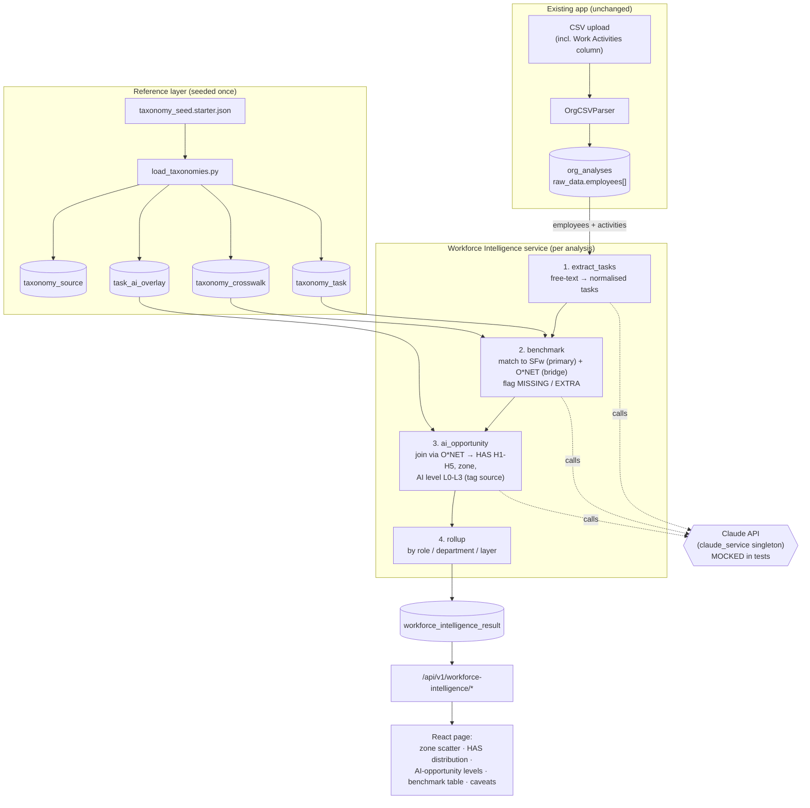
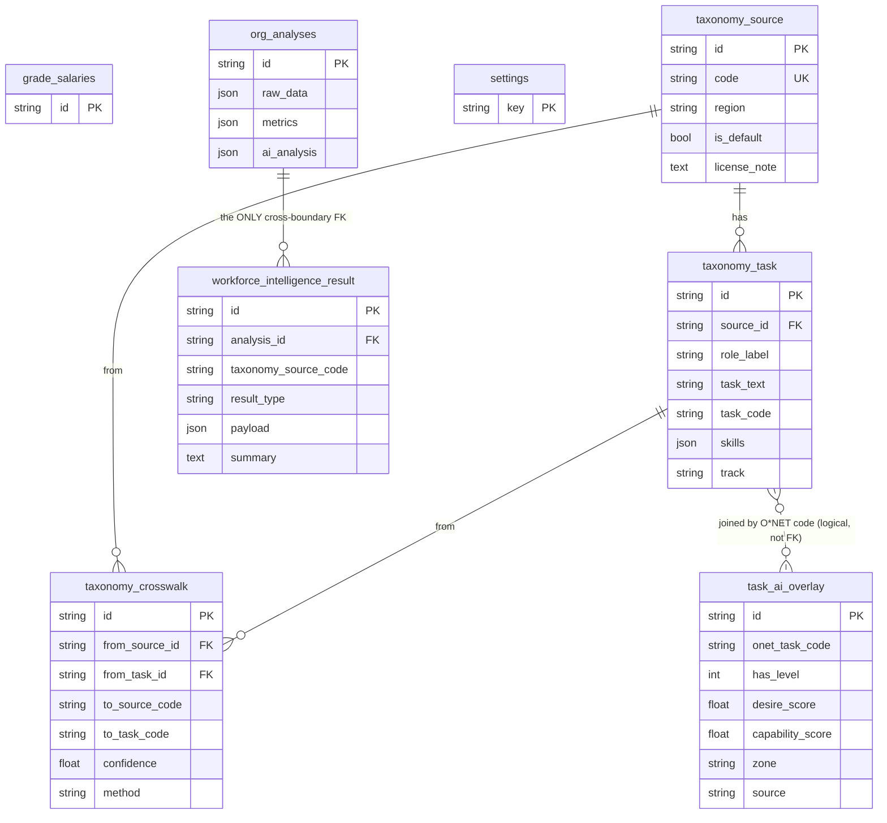

# Workforce Intelligence Module — Architecture

Companion to `WORKFORCE_INTELLIGENCE_SPEC.md`. Two views: the **data-flow / pipeline** (how a
request travels through the system) and the **entity relationships** (how the new tables attach
to the existing schema). Diagrams are Mermaid so they render on GitHub and are editable by Claude
Code.

---

## 1. The separation boundary (read this first)

The module is built *inside* the app but is **walled off**. Everything new lives in its own
service, router, page, reference tables, and a single results table. The **only** place it
touches the existing schema is one foreign key: `workforce_intelligence_result.analysis_id →
org_analyses.id`. Remove the module by deleting its files and dropping its five tables; nothing
else in the app depends on it.

Three layers:

1. **Reference layer (static, seeded):** the pluggable taxonomies — SkillsFuture (SFw, default
   for SATS), O*NET (the bridge), and the WORKBank overlay. Loaded once from seed files.
2. **Pipeline layer (per analysis):** extract tasks from free-text activities → benchmark against
   the taxonomy → attach the human-AI overlay → roll up the org graph. Claude does the language
   work; the org graph already lives in `OrgAnalysis.raw_data`.
3. **Presentation layer:** a new React page with the zone scatter, HAS distribution, AI-opportunity
   levels, and a benchmark table — plus a caveats box so provenance is always visible.

---

## 2. Data-flow / pipeline

**Notes on the flow:**
- The pipeline reads the org graph from the existing `org_analyses` table — it never re-parses
  the CSV and never modifies that table.
- Every Claude call is routed through the existing `claude_service` singleton and is
  monkeypatched in tests, so the suite runs offline and free.
- The human-AI overlay (`task_ai_overlay`) is reached **only via the O*NET code**, because
  WORKBank is keyed to O*NET. Tasks with no overlay row (e.g. physical ramp handling) are tagged
  `model-inferred` and surfaced as a different (robotics/GSE) automation lever, not a software-agent
  opportunity.

---

## 3. Entity relationships

**Notes on the schema:**
- `grade_salaries`, `org_analyses`, and `settings` are existing tables — shown only to make the
  boundary explicit. They are **not modified**; migration `002` is additive.
- `task_ai_overlay` is joined to tasks *logically* by `onet_task_code` (via the crosswalk),
  not by a hard FK — this keeps the overlay independently replaceable when you swap in real
  WORKBank pulls.
- `workforce_intelligence_result.analysis_id → org_analyses.id` is the single dependency that
  crosses into the existing app. Dropping the five new tables fully detaches the module.

---

## 4. How the two requested capabilities map onto this

- **"Calibrate against external benchmark of jobs and tasks"** = the **benchmark** step, reading
  `taxonomy_task` (SFw primary, O*NET bridge) and `taxonomy_crosswalk`, producing MATCHED /
  MISSING / EXTRA per role.
- **"Analyse human-AI opportunity using a human-agency architecture"** = the **ai_opportunity**
  step, reading `task_ai_overlay` (HAS + four zones) and adding the L0–L3 transformation lens,
  then the **rollup** that lifts task-level signals up to department and layer — the thing a
  standalone tool can't do because it lacks your org graph.
